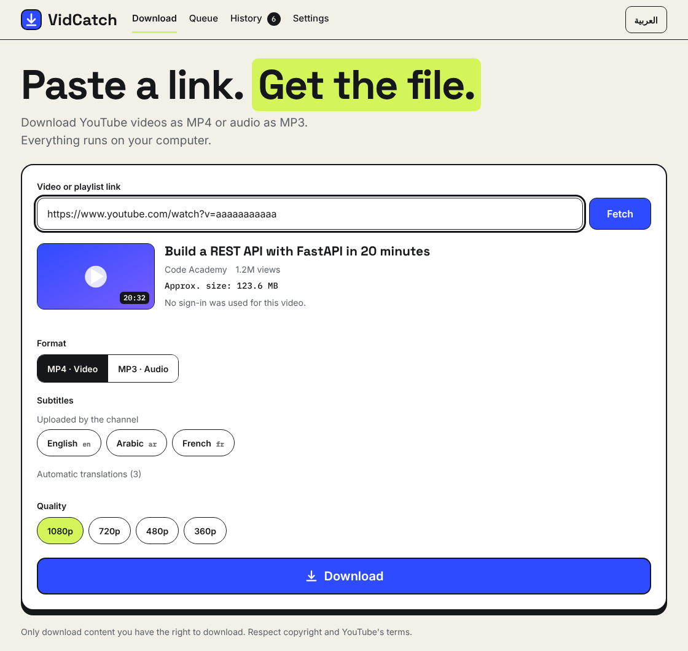
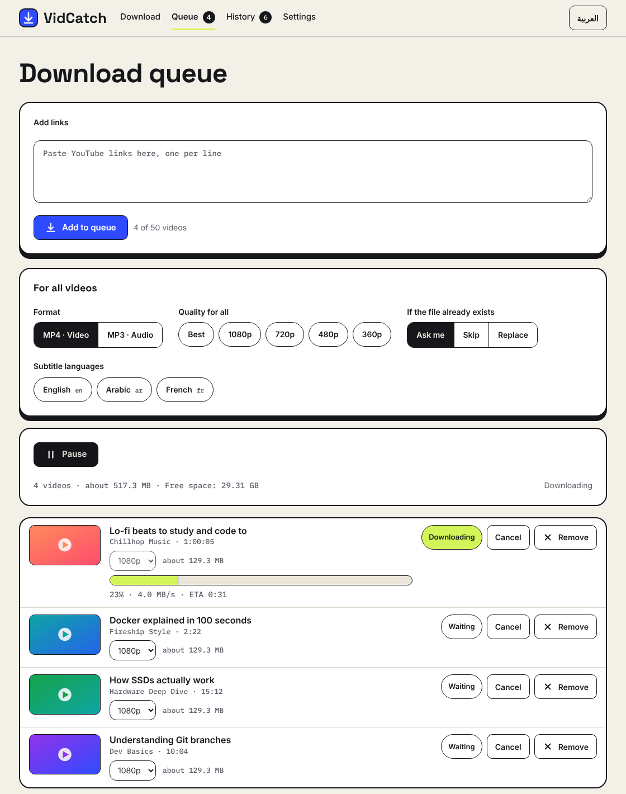
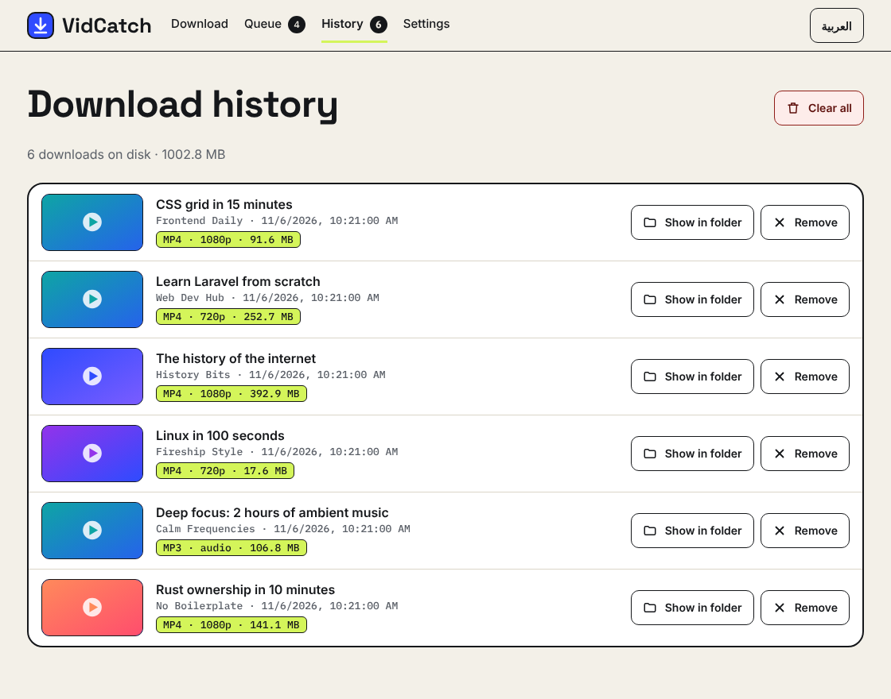
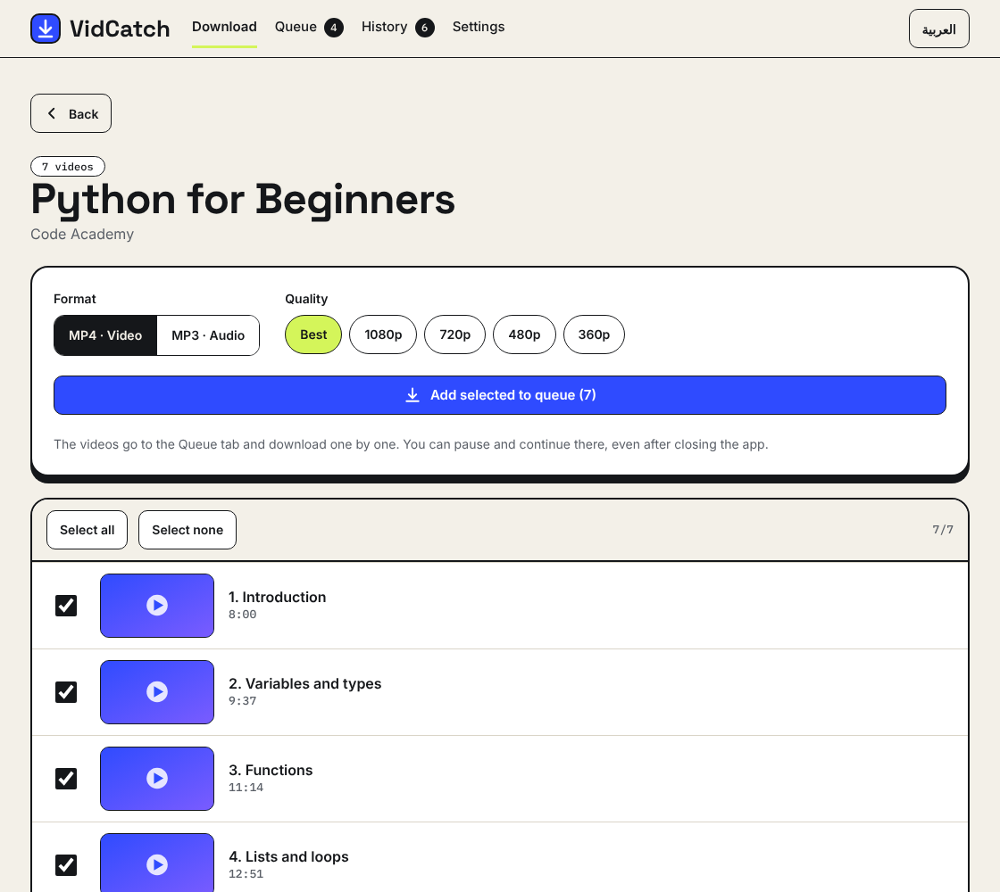
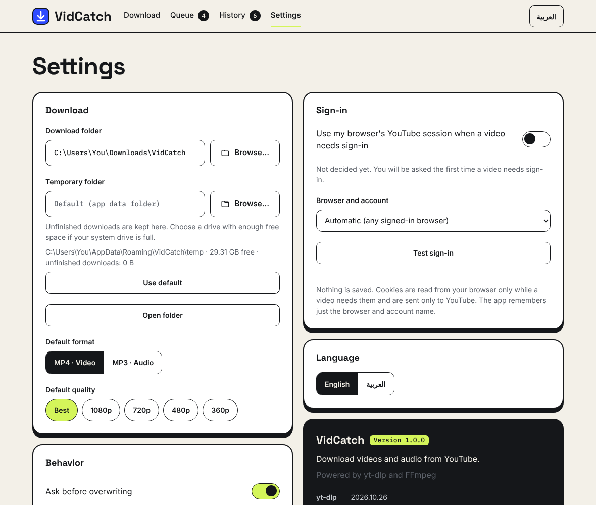
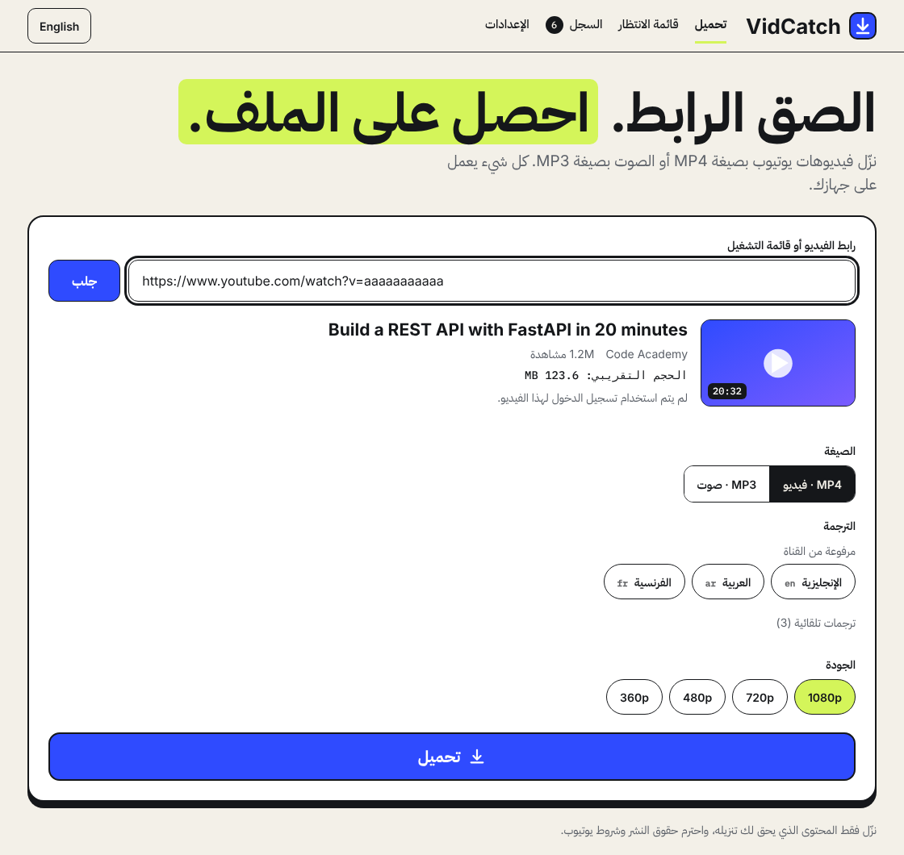

# VidCatch

Catch videos, audio and playlists from YouTube and keep them on your computer. VidCatch runs **locally**
(a small server on your own PC plus a browser page), built on [yt-dlp](https://github.com/yt-dlp/yt-dlp).
English and Arabic (RTL) interface.



## Features

- Download video (MP4) or audio only (MP3) in the quality you choose (best, 1080p, 720p, 480p, 360p)
- Playlist support with per-item progress, a downloaded / skipped / failed summary, and cancel
- Download queue: paste many links, choose one quality for all or per video, and download them one by one
- Pause and resume: unfinished downloads are kept (for 7 days) and continue from where they stopped, even after
  closing the app
- Subtitle picker: every language the video has; the video and its `.srt` files go in a folder named after it
- Storage overview: total size of your downloads in History, estimated size and free space in the queue
- Live progress with speed and ETA, cancel at any time
- Download history with "Show in folder" and "Remove"
- Settings panel: download folder, default format and quality, browser cookies for sign-in, overwrite prompt, and more
- English and Arabic interface with full right-to-left layout
- Videos are always tried without logging in first. Only if YouTube refuses one (age-restricted,
  private, members-only, or its "confirm you're not a bot" check) does the app offer to use the YouTube
  session of a browser you are already logged in with, and only if you allow it. You choose the browser
  and the account (browser profile) in Settings, and can turn it off at any time. Nothing is saved: no
  cookie files, only the browser and profile name
- Checks for a newer yt-dlp on start and updates it with one click (can be turned off in Settings)
- Settings and history are stored in a per-user folder, not next to the code

| Queue | History |
| --- | --- |
|  |  |

| Playlist | Settings |
| --- | --- |
|  |  |

The interface also works fully right-to-left in Arabic:



> The screenshots use sample data.

## Requirements (to run from source)

- Python 3.10 or newer
- [FFmpeg](https://ffmpeg.org/) — needed to merge video and audio and to make MP3 files.
  The app offers to install it on first start (winget on Windows, Homebrew on macOS, apt on Linux).
- A JavaScript runtime — [Deno](https://deno.com/) (recommended), [Node.js](https://nodejs.org/)
  or [Bun](https://bun.sh/). Optional: the app first tries without one and uses it only as a
  retry when YouTube answers `HTTP Error 403` or hides formats. The app shows a banner if none is found.

## Download (no Python needed)

Get the build for your system from the [Releases page](https://github.com/Youssef-Mekkawy/VidCatch/releases/latest):

| System | File | Start it |
| --- | --- | --- |
| Windows | `VidCatch-windows.zip` | Unzip, open the `VidCatch` folder, run `VidCatch.exe` |
| Linux | `VidCatch-linux.tar.gz` | `tar -xzf VidCatch-linux.tar.gz && ./VidCatch/VidCatch` |
| macOS | `VidCatch-macos.tar.gz` | `tar -xzf VidCatch-macos.tar.gz && ./VidCatch/VidCatch` |

Check a download against `SHA256SUMS.txt` on the same page. The builds are not code-signed, so Windows
SmartScreen or macOS Gatekeeper may warn on first start (Windows: "More info" then "Run anyway"; macOS:
right-click the file, then Open). FFmpeg is not included; VidCatch offers to install it on first start.

## Install and run (from source)

```bash
git clone https://github.com/Youssef-Mekkawy/VidCatch.git
cd VidCatch

python -m venv .venv
# Windows: .venv\Scripts\activate      macOS/Linux: source .venv/bin/activate

pip install -r requirements.txt
python -m vidcatch               # opens VidCatch in its own window (or your browser)
```

Or install it as a package, which adds the `vidcatch` command:

```bash
pip install .
vidcatch
```

Keep yt-dlp up to date, because YouTube changes often:

```bash
pip install -U "yt-dlp[default]"
```

Developer documentation: [docs/ARCHITECTURE.md](docs/ARCHITECTURE.md) and [docs/API.md](docs/API.md).

## Where your data is stored

| OS | Folder |
| --- | --- |
| Windows | `%APPDATA%\VidCatch` |
| macOS | `~/Library/Application Support/VidCatch` |
| Linux | `~/.config/vidcatch` |

The folder holds `config.json`, `history.json`, `queue.json` (the download queue) and a `temp/` folder (movable in Settings) used
while downloading (it keeps the unfinished downloads under `partial_*` for up to 7 days).
Data from the old name (`YouTubeDownloader`) is picked up automatically. Set the `YTDL_DATA_DIR` environment variable to use a different location.

## Project structure

```
vidcatch/
  server/                Local web server: API, jobs, queue, security, launcher
  web/                   Browser UI (plain HTML, CSS and JavaScript modules, EN/AR translations)
  downloader.py          yt-dlp wrapper: options, formats, progress, resumable download
  config.py              Settings, history and data folder
  signin.py              Browser profiles and sign-in fetch (nothing is written to disk)
  system.py, updates.py  FFmpeg and JS runtime detection, yt-dlp update check
  errors.py              Error codes (see docs/ERRORS.md)
tests/                   pytest suite (no network needed)
```

## Development

```bash
pip install -e ".[dev]"

ruff check .      # lint
pytest -q         # tests
```

CI runs lint, a byte-compile check and the tests on Linux and Windows (Python 3.10 and 3.12).

When you add a string, add it to both languages in `vidcatch/web/locales/en.json` and `ar.json`; the tests fail if the
two languages drift apart or a key is unused.

## Troubleshooting

**`HTTP Error 403: Forbidden`, or "Only images are available" in the log**
Install Deno or Node.js, restart the app, and update yt-dlp (`pip install -U "yt-dlp[default]"`).

**"Sign in needed" (age-restricted, private, members-only, or the bot check)**
YouTube will not give these videos to anonymous visitors. The first time it happens the app explains and
asks for permission. If you allow it, it reads the YouTube session of a browser where you are logged in.
Cookies stay on your PC and are sent only to YouTube; the app stores just the browser and profile name.

- Open Settings > Sign-in to pick the browser and account, and press **Test sign-in** to see which
  browsers can be used.
- **Firefox** is the most reliable, even while it is open.
- **Chrome and Edge on Windows** often lock their cookie database while open (close the browser fully),
  and newer versions encrypt cookies in a way yt-dlp may not be able to read. Use Firefox if the test
  reports "locked" or "encrypted".
- Using an account with yt-dlp can get it limited
  ([details](https://github.com/yt-dlp/yt-dlp/wiki/Extractors#exporting-youtube-cookies)), so a spare
  account is safer.
- If it still fails: update yt-dlp (the app offers this, or run `pip install -U "yt-dlp[default]"`) and
  try without a VPN.

**"FFmpeg not found"**
Install FFmpeg and make sure `ffmpeg` works in a terminal, then restart the app.

## Legal

Download only content you own or have permission to download. Respect YouTube's Terms of Service
and the copyright laws of your country. This project is not affiliated with YouTube or Google.

## License

[MIT](LICENSE)
